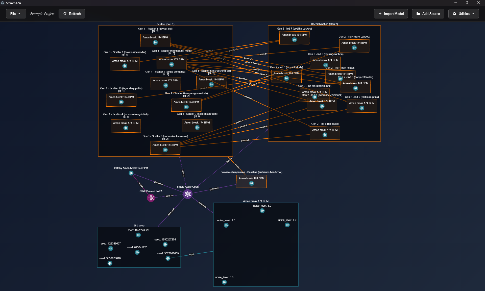

# StemmA2A

**StemmA2A** is a desktop workbench for exploring generative models (Stable Audio, StyleGAN2) through a node graph. You can generate audio and images, bend a model's internals with *gratings*, and evolve model modifications by ear: you listen, score, and breed the variants you like. Every artifact, model and modification is a node, and the edges between nodes record where each one came from.



StemmA2A is built on two companion libraries:

- [Diffracture](https://github.com/NeuralNotW0rk/Diffracture) handles model interventions: LoRA, network bending, and gratings.
- [Neutral Selection](https://github.com/NeuralNotW0rk/NeutralSelection) handles the evolutionary operators.

> **Status:** early alpha (`1.0.0` in `package.json`). Developed and tested on Windows. Project files are migrated automatically, but other behavior may change between versions.

---

## Contents

- [Installation](#installation)
- [Core concepts](#core-concepts)
- [Quickstart](#quickstart)
- [Documentation](#documentation)
- [Scripts and tests](#scripts-and-tests)
- [Known limitations](#known-limitations)
- [Related projects](#related-projects)
- [License](#license)

---

## Installation

Clone StemmA2A next to its two companion libraries:

```bash
git clone https://github.com/NeuralNotW0rk/StemmA2A.git
git clone https://github.com/NeuralNotW0rk/Diffracture.git diffracture
git clone https://github.com/NeuralNotW0rk/NeutralSelection.git neutral-selection
```

Then install the dependencies and start the app in development mode:

```powershell
cd StemmA2A
npm.cmd install
npm.cmd run backend:setup   # creates backend/.venv with PyTorch, requirements, and both libraries
npm.cmd run dev
```

**Requirements:**
- Node.js
- Python 3.10, available as `py -3.10`
- An NVIDIA GPU (recommended)

[Getting started](docs/getting-started.md) has the full setup, including the optional `.env` settings.

---

## Core concepts

| Concept | Role |
|---|---|
| **Project** | A folder containing `graph.json` and its generated files. |
| **Model** | An imported generator, through either the Stable Audio Tools adapter or the StyleGAN2 adapter. |
| **Grating** | A Diffracture intervention on a model's layers, applied at generation time with a strength. |
| **Individual** | A candidate in an evolutionary run. It carries a per-layer LoRA genome. |
| **Exemplar** | Audio or an image generated with an individual's genome applied. This is how you judge the individual. |
| **Scatter / Recombine** | Mutation-only offspring, or selection plus crossover plus mutation from parents you scored. |
| **Room** | A sub-view of the graph that you create with **Break Out**. |

The [Core concepts](docs/concepts.md) page has the full glossary.

---

## Quickstart

1. **File ▾ → New Project...**: create a project.
2. **+ Import Model**: import a model, either from local files or from `backend/shared_models.json`.
3. Right-click the model, choose **Generate**, then **Run**.
4. Right-click a clip you like, choose **Scatter**, and listen to the children.
5. **Score** the children you like, then **Recombine** them into the next generation.

---

## Documentation

| Guide | Audience |
|---|---|
| [Getting started](docs/getting-started.md) | Everyone |
| [Core concepts](docs/concepts.md) | Everyone |
| [The interface](docs/user-guide/interface.md) · [Workflows](docs/user-guide/workflows.md) · [Operations reference](docs/user-guide/operations-reference.md) | Users |
| [Architecture](docs/developer/architecture.md) · [Extending](docs/developer/extending.md) · [Remote GPU engine](docs/developer/remote-engine.md) | Developers |
| [Documentation style](docs/STYLE.md) | Contributors |

---

## Scripts and tests

| Command | Description |
|---|---|
| `npm.cmd run dev` | Starts the app with hot reload. Also starts the Python backend. |
| `npm.cmd test` | Runs the backend unit tests and the frontend typecheck. |
| `npm.cmd run test:backend` | Runs the backend `unittest` suite from `backend/`. |
| `npm.cmd run typecheck` | Runs `tsc` and `svelte-check`. |
| `npm.cmd run build:win` | Builds the installer. `build:mac` and `build:linux` are the other platforms. |
| `npm.cmd run docker:build-gpu` | Builds the remote engine image and exports it to `execution-engine.tar`. See [Remote GPU engine](docs/developer/remote-engine.md). |

On PowerShell, use `npm.cmd` rather than `npm` so the execution policy doesn't block the scripts.

---

## Known limitations

- **Packaged installers don't include the Python backend yet.** Run from source with `npm.cmd run dev`.
- **Only Windows is tested.** Apple Silicon Macs have an untested setup path (`npm run backend:setup:mac`),
  and they run on the CPU only. See [Getting started](docs/getting-started.md#macos-untested).

[Known issues](docs/developer/known-issues.md) has the full list.

---

## Related projects

- [Diffracture](https://github.com/NeuralNotW0rk/Diffracture): a modular PyTorch library for model interventions (LoRA, DoRA, network bending). It provides StemmA2A's gratings.
- [Neutral Selection](https://github.com/NeuralNotW0rk/NeutralSelection): a typed, composable evolutionary-computation framework. It provides StemmA2A's selection, crossover and mutation.

---

## License

StemmA2A is released under the [MIT License](LICENSE).
