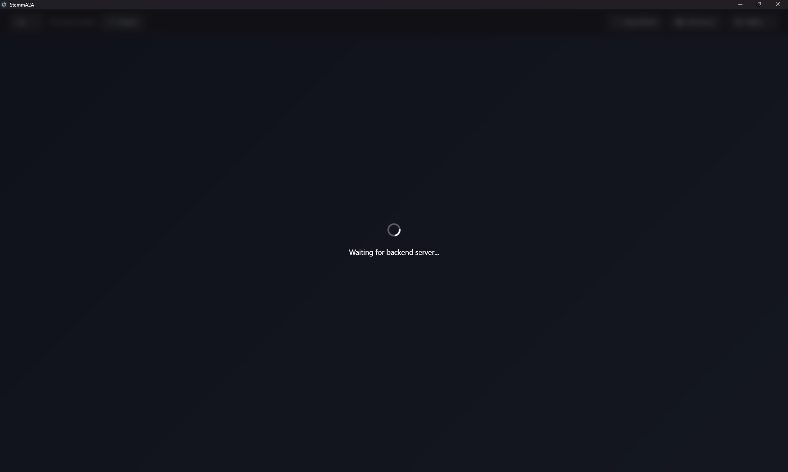
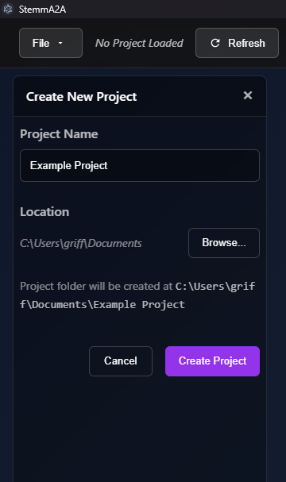

# Getting started

This page takes you from a fresh clone to a running app with your first project.

---

## Requirements

- **Windows** is the main development platform. The setup scripts are PowerShell, and the Electron
  main process expects `backend/.venv/Scripts/python.exe`.
- **Node.js** and npm.
- **Python 3.10**, available as `py -3.10`.
- An NVIDIA GPU is strongly recommended. The CPU works for small tests only.
- The sibling repositories are cloned next to this one:

  ```
  GitHub/
  ├── StemmA2A/
  ├── diffracture/          # model interventions: gratings, LoRA, network bending
  └── neutral-selection/    # evolutionary-computation framework
  ```

---

## 1. Install

```powershell
npm.cmd install            # Electron/Svelte dependencies
npm.cmd run backend:setup  # creates backend/.venv and installs PyTorch + requirements
```

`backend:setup` runs [`backend/setup.ps1`](../backend/setup.ps1), which does the following:

1. Creates `backend/.venv` with Python 3.10.
2. Installs `torch==2.7.1`, using the CUDA 12.6 build if `nvidia-smi` finds a GPU and the CPU build otherwise.
3. Installs [`backend/requirements.txt`](../backend/requirements.txt).
4. Tries to install `flash-attn`. It only warns if the install fails.
5. Installs `../diffracture` and `../neutral-selection` in editable mode.

> On PowerShell, use `npm.cmd` instead of `npm` so the execution policy doesn't block the scripts.

---

## 2. Configure (optional)

Copy `.env.example` to `.env` at the repo root. Every setting has a default. You only need `.env` when:

| Variable | Use |
|---|---|
| `ENGINE_URL` | Runs generation on a remote GPU engine instead of in-process. See [Remote GPU engine](developer/remote-engine.md). |
| `LOCAL_DATA_PATH` | Where the shared data cache lives. The default is `~/.stemma2a_data`. |
| `CF_ACCESS_CLIENT_ID` / `CF_ACCESS_CLIENT_SECRET` | Credentials for a Cloudflare-tunneled remote engine. |
| `RUN_LOCAL_BACKEND=false` | Stops Electron from starting the Python backend, for when you run it yourself. |

To make models available to every project without importing them one by one, copy
`backend/shared_models.json.example` to `backend/shared_models.json` and edit the paths. The
[Import a model](user-guide/workflows.md#import-a-model) section explains how this file is used.

---

## 3. Run

```powershell
npm.cmd run dev
```

The app starts the Python backend for you. In development on Windows, the backend opens in its own
console window, which shows the backend logs. Until the backend answers, the app window shows
*"Waiting for backend server..."*.



---

## 4. Create your first project

A **project** is a folder holding a `graph.json` file, plus the files generated for that project.

1. Open **File ▾ → New Project...**.
2. Type a **Project Name** and pick a **Location**. The panel shows where the folder will be created.
3. Click **Create Project**.



To reopen a project later, use **File ▾ → Open Project...** and select its `graph.json`, or choose it
under **Recent Projects**, which holds the last 10 projects.

Next, read [Core concepts](concepts.md), then follow
[Workflows → Import a model](user-guide/workflows.md#import-a-model).

---

## Running the tests

```powershell
npm.cmd test                 # backend unit tests + frontend typecheck
npm.cmd run test:backend     # backend only (unittest, run from backend/)
npm.cmd run typecheck        # tsc + svelte-check
```

---

## Building installers

```powershell
npm.cmd run build:win    # or build:mac / build:linux
```

> Packaged builds don't include the Python backend yet. See [Known issues](developer/known-issues.md).
