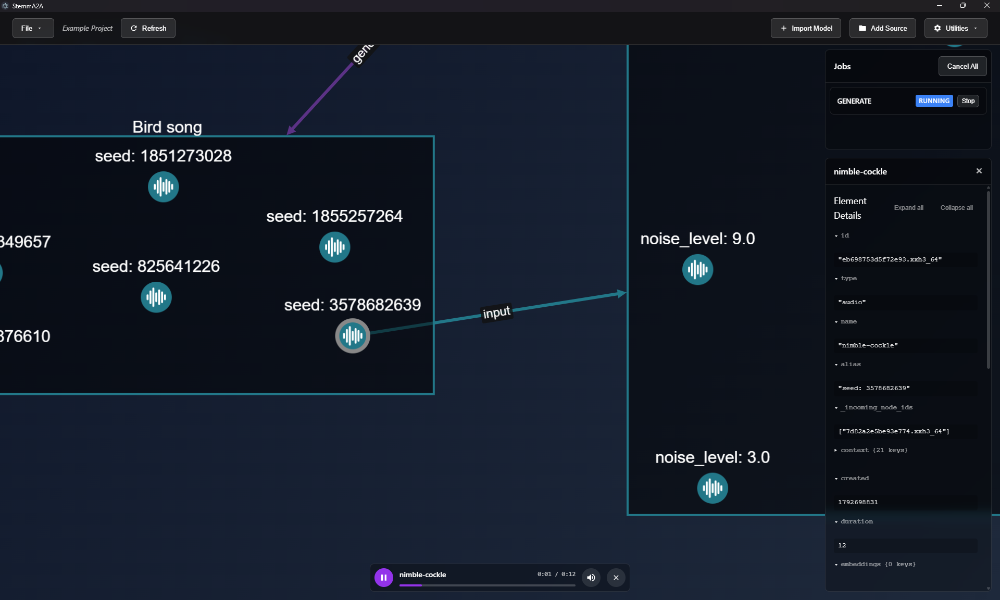
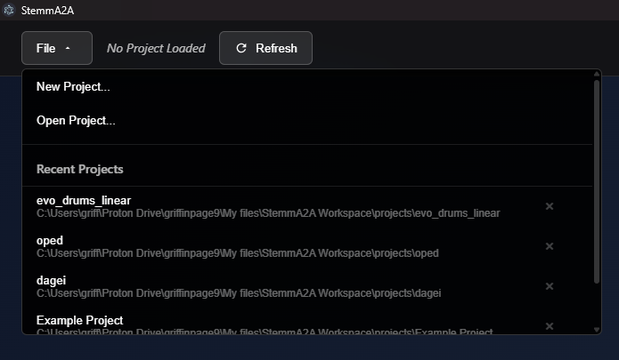
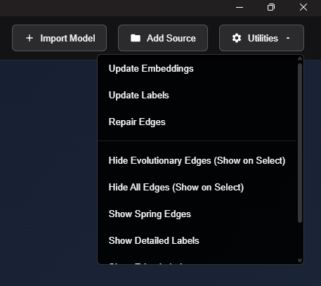
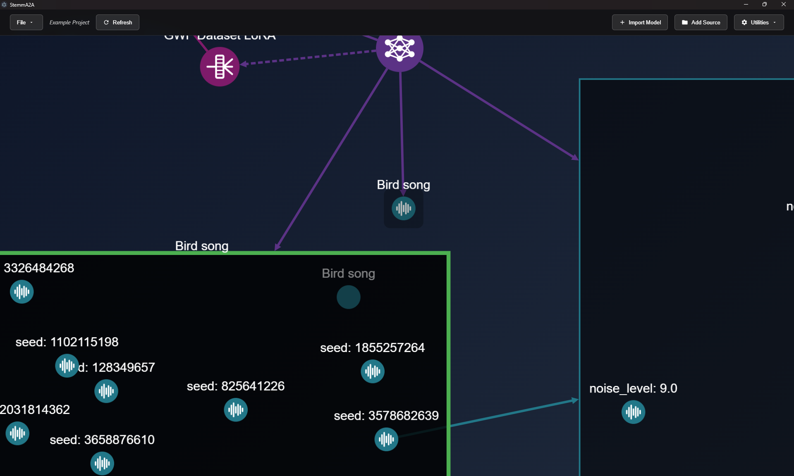
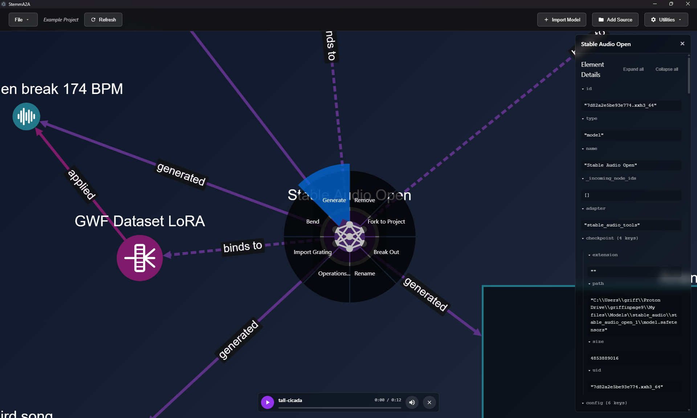
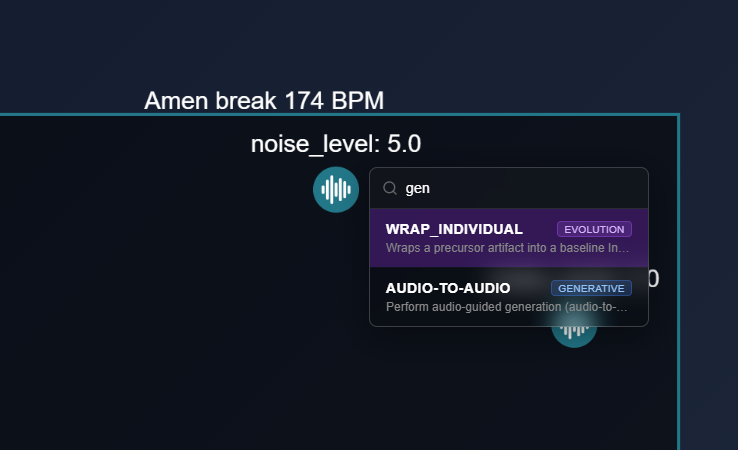
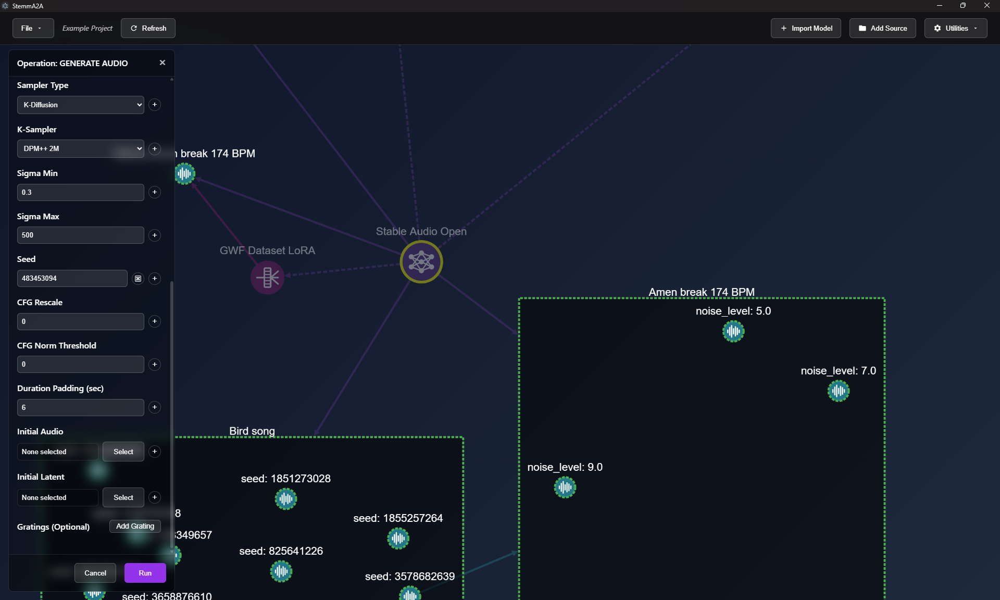
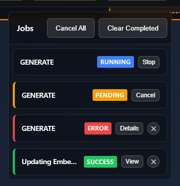
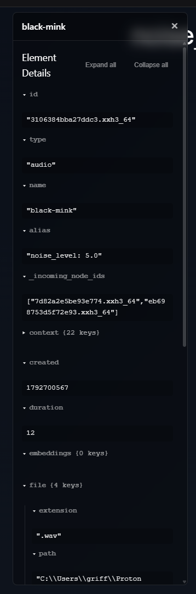
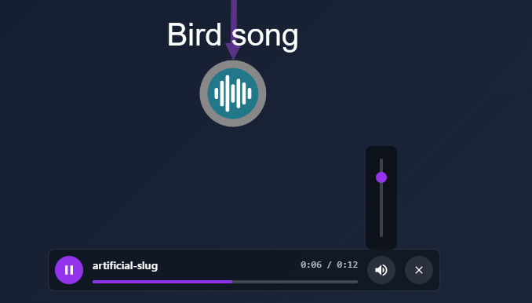

# The interface

The app has no native menu bar. Every command is in the in-app toolbar or on the right-click menus.

| Area | Position | What it shows |
|---|---|---|
| **Toolbar** | Top | Project menu, breadcrumb, view mode, import and utility actions |
| **Graph canvas** | Fills the window | The parameter graph |
| **Left panel** | Left, 320 px | One task panel at a time: an operation form, import, bending, confirmations, messages |
| **Jobs** | Top right | Background jobs. Shown only when there are jobs |
| **Element details** | Right | Properties of the selected node or edge |
| **Audio player** | Bottom center | Playback of the selected audio |
| **Image preview** | Bottom center | The selected image |

---

## Toolbar

- **File ▾** has *New Project...*, *Open Project...* and up to 10 **Recent Projects**.
  Click **×** next to a recent project to remove it from the list.
- **← Origin**: only shown in a forked project. It returns to the project the fork came from.
- **Breadcrumb**: shows the project name and, when you are inside a room, the path
  `Project › Room › Subroom`. Click any earlier crumb to go back up to it.
- **Refresh**: reloads the graph from the backend.
- **+ Import Model**: opens the [Import Model](workflows.md#import-a-model) panel.
- **Add Source**: adds an external folder of audio or images to the graph.
- **Utilities ▾**:

  | Item | Effect |
  |---|---|
  | Update Embeddings | Recomputes the similarity embeddings and spring edges. Runs as a job. |
  | Update Labels | Re-derives automatic group and member labels. |
  | Repair Edges | Rebuilds structural edges from each node's recorded context. |
  | Clean Up Project Files... | Lists files in `generate/`, `process/` and `cache/` that no element uses any more. **Move to Trash** moves them to the project's `.trash/` folder. From there each batch can be restored, or deleted permanently to free the space. Disabled while jobs are running. |
  | Hide/Show Evolutionary Edges | Hides the lineage edges between individuals. They reappear for the selected node. |
  | Hide/Show All Edges | Hides every edge except spring edges. Edges reappear for the selected node. |
  | Show/Hide Spring Edges | Shows or hides the similarity edges. |
  | Show/Hide Detailed Labels | Shows each node's name with its alias or prompt. Hold **Alt** to peek without turning it on. |
  | Show/Hide Edge Labels | Labels each edge with what it means, such as *generated*, *binds to* or *parent of*. Spring edges keep their own labels. |
  | Enable/Disable Chronological Layout | Lays generated items out from left to right in creation order. |

---

## The graph

### Node types

| Node | Looks like | Color |
|---|---|---|
| Model | Large circle, model icon | Purple `#5b3285` |
| Grating | Circle, grating icon | Magenta `#7e1b6a` |
| Audio / Image | Small circle, audio or image icon. A favorite has a cyan ring. | Teal `#227788` |
| Latent | Small circle. The label is the prompt, with `x<strength>` on a second line. | Crimson `#8f004a` |
| Individual | Box with a dashed orange border and DNA icon, labeled `name [fit: X]`. It contains the individual's exemplars. | Orange `#ff7a00` |
| Duplicate individual | Box with a dotted, lighter-orange border and a `[Duplicate]` tag | Orange `#ffa726` |
| Group | Dark translucent box with a border in the color of its member type | Varies by member type |
| Source (folder) | Large circle, folder icon | Blue `#004294` |
| Directory | Box with a blue border | Blue |
| Room | Rounded box with a double grey border, labeled `Name · N inside` | Grey |

### Edges

Edges are arrows, colored by the type of their source node: purple from models, magenta from
gratings, teal from audio and images, crimson from latents, orange from individuals.
Some relations have their own style:

- **Dashed:** a grating's `binds_to` link to its model, and group membership.
- **Dotted orange:** `shares_phenotype` (duplicates) and `expressed_to` (an individual to its expressed grating).
- **Yellow, faint:** spring (similarity) edges, when they are shown. Thicker means more similar.

When an edge points into every member of a group, it is drawn as a single edge into the group box.

### Mouse and keyboard

| Action | Result |
|---|---|
| Click a node | Selects it and opens its details. Audio starts playing; an image opens in the preview card. |
| Click empty canvas | Clears the selection |
| Drag on empty canvas | Box-selects |
| Double-click a node | Zooms to the node |
| Double-click a room | Enters the room |
| Double-click empty canvas | Fits the whole graph in view |
| **Ctrl**+drag a node | Moves the node into a compatible group (highlighted green) or, dropped on empty canvas, out of its group |
| Right-click | Opens the radial menu: hold, move to an item, release |
| **Delete** / **Backspace** | Removes the selection, after a confirmation |
| **Space** | Plays or pauses audio |
| **Alt** (hold) | Shows detailed labels temporarily |
| **Esc** | Closes menus and cancels pick mode |

A group only accepts a node with the same type, the same prompt and the same inputs as its members.

### The radial menu

Right-click a node to see the actions available for its type:

| Node | Actions |
|---|---|
| Model | Generate, Bend, Import Grating, Operations… |
| Grating | Generate, Operations… |
| Latent | Replicate, Generate, Operations… |
| Audio | Favorite, Replicate, Export, Operations… |
| Image | Favorite, Replicate, Operations… |
| Individual | Score, Scatter, Operations… |
| Group | Recombine, Update Group, Export Group, Operations… |
| Source | Expand |
| Room | Enter Room, Rename, Rejoin |
| Empty canvas | Tidy, Fit, Create Group |
| Edge | Remove |

All nodes except rooms also have **Rename**, **Break Out**, **Fork to Project** and **Remove**.
If the node you right-click is part of a multi-selection, the action applies to the whole selection.

**Replicate** reopens the operation that created a node, with that node's settings already filled in.
Use it to make variations.

### The Operations palette

**Operations…** opens a searchable list of every operation that accepts the node.
Move with **↑/↓**, run with **Enter**, close with **Esc**.

---

## Operation forms

Operation panels are built from the backend's form definitions. Some controls work the same across
all of them:

- **Node fields**: click **Select** to pick a node on the graph. Valid targets get a green border and
  everything else dims. Click the field to center the chosen node in view, or **×** to clear it.
  **+** switches the field to a list, so you can run the operation on several nodes. Picking a group
  adds all of its members.
- **🎲 Randomize**: rolls a new random value, for example a seed.
- **Sequence mode (+/−)**: some fields accept a list of values such as `1, 2, 5..10:2`
  (`start..end:step`). The operation then runs once for **every combination** of the sequence
  values, and all the results go into one new group.

---

## Jobs

Long-running work (generation, scatter, recombine, model import, export) runs as a **job**.
The Jobs panel lists running jobs first, then pending jobs, then finished jobs with the newest first.

| Status | Buttons |
|---|---|
| Running | **Stop** |
| Pending | **Cancel** |
| Succeeded | **View** zooms to the new node · **×** dismisses the job |
| Failed | **Details** shows the error and the Python traceback · **×** dismisses the job |

Use **Cancel All** and **Clear Completed** in the panel header to manage several jobs at once.

> **Stop** discards the job's result, but the work already started finishes in the background.
> Jobs queued behind it start once it's done.
The graph refreshes automatically when a job succeeds.

---

## Element details

The right-hand panel shows every property of the selected element as a tree you can expand and
collapse. The most useful property is **context**: the exact operation and parameters that produced
the element. For models, the panel also has a **Share with Engine** button, which makes the model
available to every project from the **Shared Models** tab of Import Model.

---

## Audio player

Selecting an audio node loads it and starts playback. The player has play/pause, a seek bar
(**←/→** seek 5 s when the bar has focus) and volume.

