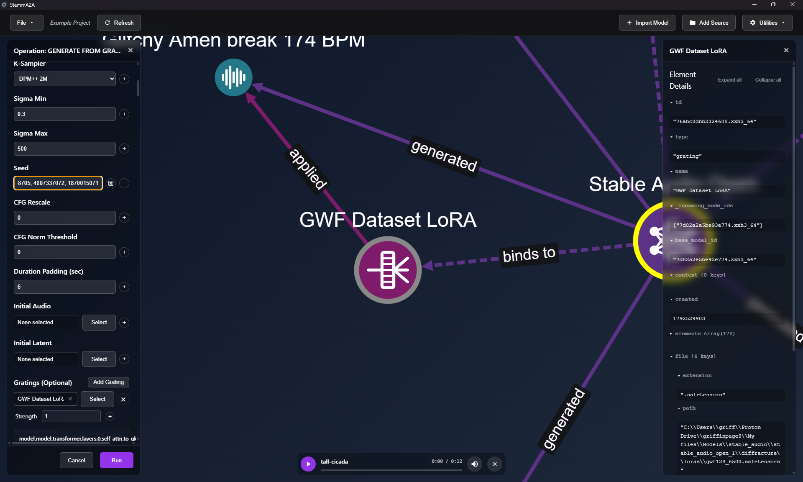

# Operations reference

Operations are what you run on nodes. Open one from a node's radial menu or from the
**Operations…** palette. The form fields listed below come from the JSON configs in the backend.
Those files are the source of truth, so if a default here disagrees with the app, the app is right.

Hover over any field in the app to see a full explanation of it in the tip view, the panel in the
bottom-left corner. The tables below summarize those explanations. Some fields only appear in certain
cases: a field that an attached node makes irrelevant (such as an initial latent) is hidden, and one
that another setting makes irrelevant is greyed out.

| Operation | Category | Runs on | Output |
|---|---|---|---|
| [generate](#generate) | generative | model, grating, latent, audio, individual | audio or image |
| [invert](#invert) | generative | model + audio / image | latent (+ grating for StyleGAN) |
| [wrap_individual](#wrap_individual) | evolution | audio (and other artifacts) | individual (gen 0) |
| [scatter](#scatter) | evolution | individual, audio | group of child individuals |
| [recombine](#recombine) | evolution | group, individual | group of child individuals |
| [express](#express) | evolution | individual, group | grating |
| [gain](#audio-processing) / [normalize](#audio-processing) / [slice](#audio-processing) / [librosa_onset_slice](#audio-processing) | dsp | audio | audio |

---

## generate

### Stable Audio Tools

Stable Audio models come in two families, and some fields depend on which one the model belongs to.
**K-diffusion** covers v-objective models such as Stable Audio Open 1.0. **Rectified flow** covers flow
models such as Stable Audio 3, including distilled (`rf_denoiser`) models built to finish in a few steps.

| Field | Default | Notes |
|---|---|---|
| Prompt | `Amen break 174 BPM` | Concrete terms (instruments, genre, tempo, mood) steer more reliably than abstract ones |
| Negative Prompt | `low fidelity` | K-diffusion only. Greyed out at CFG Scale 1, where it has no effect. |
| Steps | 50 (8 on distilled models) | Hidden with an initial latent, which reuses the inversion's steps. Ignored by k-DPM Adaptive. |
| CFG Scale | 7 (1 with an initial latent or on distilled models) | How strongly the result follows the prompt. 5–7 is typical; very high values sound harsh. With an initial latent, 1 reproduces the source and higher values edit it. |
| Seconds Start / Seconds Total | 0 / 12 | Timing conditions. The clip is treated as the stretch from Start to Total of a longer piece, so the output is Total − Start long. |
| Sampler Type | from the model | Read-only. K-Diffusion or Rectified Flow, set by the model's diffusion objective. |
| K-Sampler | DPM++ 2M | K-diffusion only. k-DPM Fast and k-DPM Adaptive can't be used with an initial latent. |
| RF-Sampler | Euler | Rectified flow only. Ping-pong is made for distilled models. |
| Sigma Min | 0.3 | K-diffusion only. Hidden with an initial latent. Where the sampler stops before its final jump to clean audio. |
| Sigma Max | 500 (1 for rectified flow) | Hidden with an initial latent. Where sampling starts. Keep it at 1 for rectified flow. |
| Seed | 0 | Sets the starting noise. Has a randomize button. |
| CFG Interval Min / Max | 0 / 1 | Guidance only runs while the noise level, from 0 (clean) to 1 (pure noise), is inside this range |
| CFG Rescale | 0 | Pulls an oversaturated guided output back toward the unguided one |
| CFG Norm Threshold | 0 | Caps how hard guidance can push at each step. 0 turns it off. |
| APG Scale | 1 | Blends plain guidance (0) with adaptive projected guidance (1). Set it to 0 for the classic guidance Stable Audio Open 1.0 was first used with. |
| Duration Padding (sec) | 6 | Extra seconds generated past Seconds Total, then trimmed. Models with a fixed output length ignore it. |
| Initial Audio | – | Audio-to-audio: start from an existing clip instead of pure noise |
| Noise Level | 5 (0.8 for rectified flow) | Shown with Initial Audio. How much of the source is replaced: σ for K-diffusion, 0 to 1 for rectified flow. |
| Initial Latent | – | A latent made by [invert](#invert), to regenerate or edit that sound |

The CFG interval, rescale, norm threshold and APG controls apply to both families. They only act when
CFG Scale is above 1.

### StyleGAN2

| Field | Default | Notes |
|---|---|---|
| Seed | 0 | Picks the starting vector. Greyed out with an initial latent and Randomize Noise off, where it has no effect. |
| Truncation Value | 0.7 | Pulls toward the model's average image: 1 is the full range, 0 the average itself. Hidden with an initial latent. |
| Randomize Noise | off | Off uses the model's fixed per-layer noise. Keep it off to reproduce an inverted image. |
| Initial Latent | – | A latent to render, usually a pivot from [invert](#invert). Apply the inversion's grating too to reproduce the image. |

### Gratings

When a model is selected, **Gratings (Optional)** lets you stack gratings onto the generation.
Each grating has these settings:

- **Strength**: 1 applies the grating as authored, 0 disables it, a negative value inverts it, and a
  value above 1 exaggerates it.
- **Kernel parameters**: for bending gratings.
- **Target**: *All Channels*, *Explicit Channels*, or *Unsupervised Clustering*. The clustering
  option only appears if the grating was created with feature clustering.

Gratings are applied in the order they're listed.

### Generating from an individual

When you run Generate on an individual, the panel first shows **Lineage Exemplars**. This is a list of
every exemplar setting (prompt, seed, steps and so on) already used anywhere in that individual's
ancestry. Nearer ancestors are listed first. Each entry shows how many of the selected individuals
still lack an exemplar with those settings. Tick the entries you want and click **Generate N Exemplars**,
or click **Add New Exemplar…** to start from a prefilled form instead.

---

## invert

Turns an existing clip or image into something the model can regenerate.

### Stable Audio

Produces a **latent** from an audio clip. Attach it to Generate's **Initial Latent** to regenerate or
edit the sound; generation reuses the inversion's steps and noise range automatically. K-diffusion
models are inverted by tracing an ODE from Sigma Min to Sigma Max. Rectified-flow models use
stable-audio-tools' RF-Inversion.

| Field | Default | Notes |
|---|---|---|
| Source Audio | required | Only its first Seconds Total − Seconds Start seconds are used |
| Prompt | (empty) | Conditions the inversion. Greyed out while Inversion Unconditional is on. |
| Steps | 50 | More steps reproduce more faithfully. For rectified flow, 30–50 usually work and 200 is most faithful. |
| Inversion Strength | 1.0 | K-diffusion only. How far toward pure noise to invert. Lower values keep more of the source when you generate. |
| Seconds Start / Seconds Total | 0 / 11 | The same timing conditions as Generate. The source is read from its beginning. Use the same timing when you generate. |
| Inversion Gamma | 0 | Rectified flow only. Pulls the inversion toward seeded noise: 0.3–0.5 suits reproduction, 0 suits style transfer. |
| Inversion Unconditional | on | Rectified flow only. Replaces the prompt and timing tokens with the null conditioning. Timing passed as a global condition still applies. |
| Inversion CFG Scale | 1.0 | Rectified flow only. Greyed out and held at 1 while unconditional, since the model only drops the prompt at 1. |
| Seed | 0 | K-diffusion: the faint starting noise. Rectified flow: the noise Inversion Gamma pulls toward. |
| Sigma Min / Sigma Max | 0.3 / 500 | K-diffusion only. The range the inversion traces, reused by generation. |

### StyleGAN2

Runs pivotal tuning inversion (PTI). It finds a **latent** (the pivot) and trains a small LoRA
**grating** so that generating from the pivot with that grating applied reproduces the image. The source
is center-cropped to a square and resized to the model's resolution.

| Field | Default | Notes |
|---|---|---|
| Source Image | required | |
| Projection Steps | 500 | Steps searching for the pivot latent |
| Tuning Steps | 350 | Steps training the grating. Too many can overfit and make edits look less natural. |
| LoRA Rank | 4 | Higher ranks reproduce more detail but change the model more broadly around the pivot |
| Projection Learning Rate | 0.1 | Starting step size of the pivot search, which ramps down to zero |
| Tuning Learning Rate | 0.001 | Step size for training the grating |
| Perceptual (LPIPS) Loss | on | Sharper inversions than pixel differences alone. Needs the `lpips` package; the inversion stops with an error if it is missing. |
| Seed | 0 | Sets the pivot search's exploration noise and the grating's starting weights |

---

## wrap_individual

Wraps an artifact you like (the *precursor*) as a generation-0 individual. The precursor becomes the
individual's first exemplar. A gen-0 genome has no effect yet, so the individual sounds like the
unmodified model until you scatter it.

| Field | Default | Notes |
|---|---|---|
| Precursor Artifact | required | |
| LoRA Rank | 1 | 1–128. Higher ranks give each layer more room to change. Alpha always equals the rank, so Mutation Strength means the same at every rank. |

You don't have to wrap first: **Scatter** on an audio node wraps it automatically.

---

## scatter

Creates mutated children from one parent individual. Scatter only mutates; it never crosses
genomes. To breed from several individuals, use [recombine](#recombine). The children go into a group
named **Scatter (Gen N)**.

| Field | Default | Notes |
|---|---|---|
| Parent Individual | required | A single individual |
| Scatter Count (N) | 10 | 1–100. Children identical to an existing individual are discarded, so very low σ can give fewer than N. |
| Mutation Strength (σ) | 0.1 | Measured relative to each layer's natural scale. Freshly initialized weights are about 0.6 in these units. |
| Expected On/Off Toggles per Offspring | 0.0 | How many layers flip between on and off, on average. Leave this at 0 until a lineage has developed. |
| Freeze Switched-Off Layers | on | Layers that are switched off aren't mutated, so switching one back on restores it as it was. |
| Auto-Generate Exemplars | on | Renders each child with its parent's exemplar settings. When off, use **Generate Exemplar** later. |

---

## recombine

Breeds a new generation from scored parents. It selects parents, crosses over their genomes and
applies light mutation. Each pair of parents produces one child, so ten children come from ten separate
pairings. The children go into a group named **Recombination (Gen N)**.

| Field | Default | Notes |
|---|---|---|
| Parent Individuals | required | One parent also works: it is paired with itself, so its children differ only by mutation. |
| Offspring Count (N) | 10 | Children identical to an existing individual are discarded |
| Recombination Strategy | Two-Point | See the table below |
| Selection Strategy | Tournament | **Tournament (Fitness-Biased)** picks the fittest of a few random parents. **Uniform Random** picks any parent. |
| Tournament Size | 3 | Tournament only. How many random parents compete for each slot. Larger values favor the top scorers more. Capped at the number of parents. |
| Default / Null Fitness Override | 0.0 | Fitness used for parents you haven't scored. Only rank matters: a tournament always picks its highest scorer. |
| Crossover Probability | 1.0 | Chance that a pair is crossed over. Otherwise the child is a mutated copy of one parent. |
| Mutation Rate | 0.01 | Chance that each layer is perturbed |
| Mutation Strength (σ) | 0.05 | In units of each layer's natural scale |
| Expected On/Off Toggles per Offspring | 1.0 | |
| Freeze Switched-Off Layers | on | |
| Auto-Generate Exemplars | on | Uses the *first* parent's exemplar settings |

| Strategy | What it does |
|---|---|
| Two-Point / One-Point | Cuts the two parents' genomes at one or two points and joins the pieces. The parameters are treated as one long sequence, so a cut can fall inside a layer. |
| Layer Splicing | Each layer is inherited whole, from one parent or the other, split at a single cut point |
| Uniform Swap | Each value comes from either parent with a 50/50 chance |
| Weight Average | Takes the midpoint of the two parents, layer by layer. Produces one child per pair. |

---

## express

Writes the genome of each selected individual out as a standalone **grating** named *Expressed …*,
placed inside the individual. You only need this to keep or share the modification as a file.
Generation from an individual works without expressing it first. Switched-off layers stay off in the
grating, and their stored weights aren't kept. Expressed gratings are content-addressed, so expressing
an individual again, or another individual with the same phenotype, reuses the existing grating.

| Field | Default |
|---|---|
| Individual(s) | required |

---

## Audio processing

Each of these takes a **Source Audio** node and produces new audio, linked to the source. Mono audio
comes out as stereo, and everything is resampled to 48 kHz. Files are written as 16-bit WAV, so any
sample pushed past full scale is clipped.

| Operation | Fields | Effect |
|---|---|---|
| gain | Gain (dB), 3.0 | Multiplies the level: +6 dB roughly doubles it. Nothing limits the result. |
| normalize | Target Peak, 1.0 | Scales the clip so its loudest sample equals the target, with both channels scaled together |
| slice | Chunk Duration (s), 1.0 · Overlap (s), 0.0 | Cuts the clip into fixed-length slices with no fades. Slicing stops at the first slice that reaches the end. |
| librosa_onset_slice | Sensitivity, 0.5 · Backtrack to Local Minima, on | Cuts the clip at detected onsets. Higher sensitivity also cuts at softer hits; 0.5 is librosa's standard threshold. |

---

## Model bending (Bend)

Bend isn't on the Operations list. It has its own panel, opened from a model's radial menu
(**Bend**). See [Workflows → Bend a model](workflows.md#bend-a-model).

| Field | Default | Notes |
|---|---|---|
| Target Model | the model you opened Bend from | |
| Grating Name | layer and kernel | For example `conv1.conv [erode]` |
| Target Layer | the first layer | The layer whose output is changed |
| Bending Kernel | Erode | Erode, Dilate, Scale, Rotate and Translate need a layer with 2D spatial output and are disabled otherwise. Scalar Multiply and Ablate work on any layer. |
| Precompute Feature Clustering | off | Groups the layer's channels so one group can be bent at a time |
| Number of Clusters | 5 | 2–20. Greyed out until clustering is on. |
