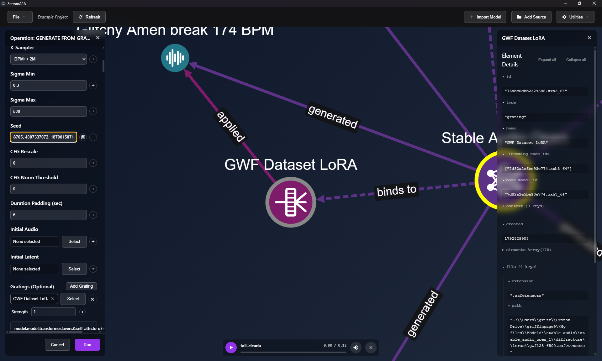

# Operations reference

Operations are what you run on nodes. Open one from a node's radial menu or from the
**Operations…** palette. The form fields listed below come from the JSON configs in the backend.
Those files are the source of truth, so if a default here disagrees with the app, the app is right.

| Operation | Category | Runs on | Output |
|---|---|---|---|
| [generate](#generate) | generative | model, grating, latent, audio, individual | audio or image |
| [invert](#invert) | generative | model + audio / image | latent (+ grating for StyleGAN) |
| [wrap_individual](#wrap_individual) | evolution | audio (and other artifacts) | individual (gen 0) |
| [scatter](#scatter) | evolution | individual, group, audio | group of child individuals |
| [recombine](#recombine) | evolution | group, individual | group of child individuals |
| [express](#express) | evolution | individual, group | grating |
| [gain](#audio-processing) / [normalize](#audio-processing) / [slice](#audio-processing) / [librosa_onset_slice](#audio-processing) | dsp | audio | audio |

---

## generate

### Stable Audio Tools

| Field | Default | Notes |
|---|---|---|
| Prompt | `Amen break 174 BPM` | Text description |
| Negative Prompt | `low fidelity` | What to steer away from |
| Steps | 50 | Diffusion steps |
| CFG Scale | 7 | Prompt adherence |
| Seconds Start / Seconds Total | 0 / 12 | Timing conditioning |
| Sampler Type | `k_diffusion` | Either `k_diffusion` or `rectified_flow` |
| K-Sampler | `dpmpp-2m` | Used with `k_diffusion` |
| RF-Sampler | `euler` | Used with `rectified_flow` |
| Sigma Min / Sigma Max | 0.3 / 500 | Noise schedule bounds |
| Seed | 0 | Has a randomize button |
| CFG Interval Min / Max, CFG Rescale, CFG Norm Threshold, APG Scale | 0 / 1, 0, 0, 1 | Advanced guidance controls |
| Duration Padding (sec) | 6 | |
| Initial Audio + Noise Level | –, 5 | Audio-to-audio: start from an existing clip |
| Initial Latent | – | Start from an inverted latent |

### StyleGAN2

| Field | Default |
|---|---|
| Seed | 0 |
| Truncation Value | 0.7 |
| Randomize Noise | off |
| Initial Latent | – |

### Gratings

When a model is selected, **Gratings (Optional)** lets you stack gratings onto the generation.
Each grating has these settings:

- **Strength**: 1 applies the grating as authored, 0 disables it, a negative value inverts it, and a
  value above 1 exaggerates it.
- **Kernel parameters**: for bending gratings.
- **Target**: *All Channels*, *Explicit Channels*, or *Unsupervised Clustering*. The clustering
  option only appears if the grating was created with feature clustering.

Gratings are applied in the order they're listed.

### Generating from an individual

When you run Generate on an individual, the panel first shows **Lineage Exemplars**. This is a list of
every exemplar setting (prompt, seed, steps and so on) already used anywhere in that individual's
ancestry. Nearer ancestors are listed first. Each entry shows how many of the selected individuals
still lack an exemplar with those settings. Tick the entries you want and click **Generate N Exemplars**,
or click **Add New Exemplar…** to start from a prefilled form instead.

---

## invert

Turns an existing clip or image into something the model can regenerate.

### Stable Audio

Produces a **latent** from an audio clip.

| Field | Default |
|---|---|
| Source Audio | required |
| Prompt | (empty) |
| Steps | 50 |
| Inversion Strength | 1.0 |
| Seconds Start / Seconds Total | 0 / 11 |
| Inversion Gamma | 0 |
| Inversion Unconditional | on |
| Inversion CFG Scale | 1.0 |
| Seed | 0 |
| Sigma Min / Sigma Max | 0.3 / 500 |

### StyleGAN2

Runs pivotal tuning inversion (PTI). It finds a **latent** (the pivot) and trains a small LoRA
**grating** so that generating from the pivot with that grating applied reproduces the image.

| Field | Default |
|---|---|
| Source Image | required |
| Projection Steps | 500 |
| Tuning Steps | 350 |
| LoRA Rank | 4 |
| Projection Learning Rate | 0.1 |
| Tuning Learning Rate | 0.001 |
| Perceptual (LPIPS) Loss | on |
| Seed | 0 |

---

## wrap_individual

Wraps an artifact you like (the *precursor*) as a generation-0 individual. The precursor becomes the
individual's first exemplar. A gen-0 genome has no effect yet, so the individual sounds like the
unmodified model until you scatter it.

| Field | Default | Notes |
|---|---|---|
| Precursor Artifact | required | |
| LoRA Rank | 1 | 1–128. Higher ranks give each layer more room to change. |
| LoRA Alpha | 1.0 | |

You don't have to wrap first: **Scatter** on an audio node wraps it automatically.

---

## scatter

Creates mutated children from one or more seed individuals. Scatter only mutates; it never crosses
genomes. The children go into a group named **Scatter (Gen N)**.

| Field | Default | Notes |
|---|---|---|
| Seed Individual(s) | required | Individuals, or groups of individuals |
| Scatter Count (N) | 10 | 1–100. Total number of children. |
| Mutation Strength (σ) | 0.1 | Measured relative to each layer's natural scale. Freshly initialized weights are about 0.6 in these units. |
| Expected On/Off Toggles per Offspring | 0.0 | How many layers flip between on and off, on average. Leave this at 0 until a lineage has developed. |
| Freeze Switched-Off Layers | on | Layers that are switched off aren't mutated, so switching one back on restores it as it was. |
| Auto-Generate Exemplars | on | Renders each child using its parent's exemplar settings |

---

## recombine

Breeds a new generation from scored parents. It selects parents, crosses over their genomes and
applies light mutation. The children go into a group named **Recombination (Gen N)**.

| Field | Default | Notes |
|---|---|---|
| Parent Individuals | required | |
| Offspring Count (N) | 10 | |
| Recombination Strategy | Two-Point | See the table below |
| Selection Strategy | Tournament | **Tournament (Fitness-Biased)** picks the fitter of two random parents. **Uniform Random** picks any parent. |
| Default / Null Fitness Override | 0.0 | Fitness used for parents you haven't scored |
| Crossover Probability | 1.0 | |
| Mutation Rate | 0.01 | Fraction of layers perturbed |
| Mutation Strength (σ) | 0.05 | |
| Expected On/Off Toggles per Offspring | 1.0 | |
| Freeze Switched-Off Layers | on | |
| Auto-Generate Exemplars | on | |

| Strategy | What it does |
|---|---|
| Two-Point / One-Point | Cuts the two parents' genomes at one or two points and joins the pieces. The parameters are treated as one long sequence, so a cut can fall inside a layer. |
| Wholesale Layer Splicing | Each layer is inherited whole, from one parent or the other, split at a single cut point |
| Uniform Element Swap | Each value comes from either parent with a 50/50 chance |
| Continuous Weight Blend (BLX) | Averages the two parents. Produces one child per pair. |

---

## express

Writes the genome of each selected individual out as a standalone **grating** named *Expressed …*.
You only need this to keep or share the modification as a file. Generation from an individual works
without expressing it first.

---

## Audio processing

Each of these takes a **Source Audio** node and produces new audio.

| Operation | Fields | Effect |
|---|---|---|
| gain | Gain (dB), 3.0 | Applies a gain |
| normalize | Target Peak, 1.0 | Scales the clip so its peak equals the target |
| slice | Chunk Duration (s), 1.0 · Overlap (s), 0.0 | Cuts the clip into fixed-length chunks |
| librosa_onset_slice | Backtrack to Local Minima, on | Cuts the clip at detected onsets |

> These are currently broken by a backend bug. See [Known issues](../developer/known-issues.md).

---

## Model bending (Bend)

Bend isn't on the Operations list. It has its own panel, opened from a model's radial menu
(**Bend**). See [Workflows → Bend a model](workflows.md#bend-a-model).
