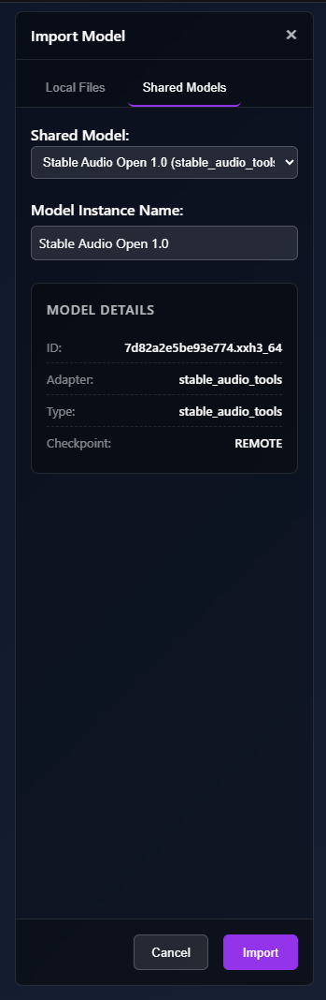
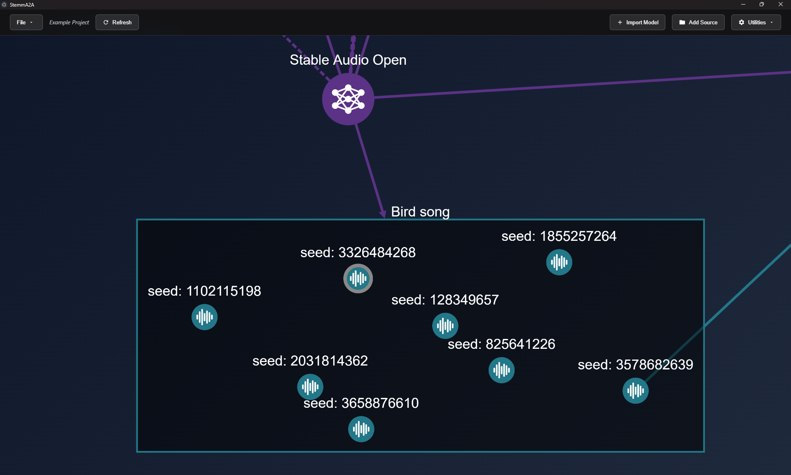
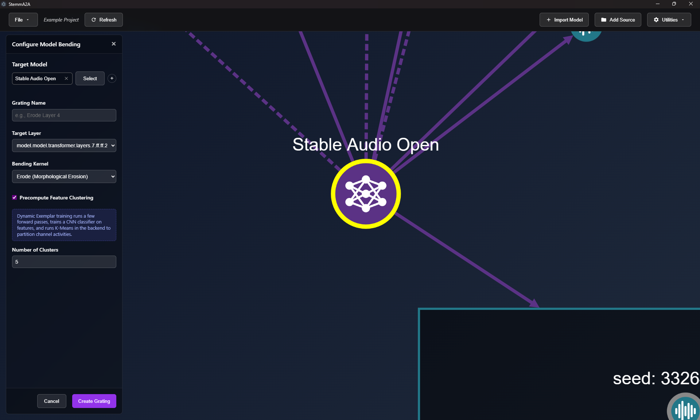
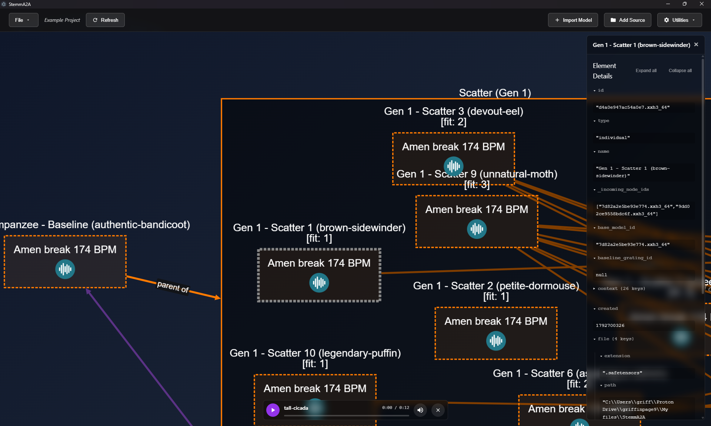
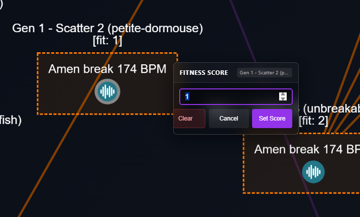

# Workflows

- [Import a model](#import-a-model)
- [Generate](#generate)
- [Bend a model](#bend-a-model)
- [Evolve a model](#evolve-a-model)
- [Bring in your own audio or images](#bring-in-your-own-audio-or-images)
- [Organize: groups, rooms, forks](#organize-groups-rooms-forks)
- [Export](#export)

---

## Import a model

Click **+ Import Model** in the toolbar. The panel has two tabs:

- **Local Files**: choose an **Adapter**, then fill in its fields.
  - **Stable Audio Tools** needs a Model Name, a Checkpoint File, a Config File, and optionally a Text
    Encoder Folder.
  - **StyleGAN2** needs a Model Name and a Checkpoint Path. Legacy `.pkl` checkpoints are supported.
- **Shared Models**: pick an entry from `backend/shared_models.json`, or from the remote engine's
  list if you use one, and click **Import**. No file browsing is needed. If the list is empty, the
  panel explains how to add entries.

Importing runs as a job. Large checkpoints take a while because the model is hashed to give it a
stable ID. When the job finishes, the model appears as a purple circle.

---

## Generate

1. Right-click a model and choose **Generate**.
2. Fill in the form. See [generate](operations-reference.md#generate) for what each field does.
3. Click **Run**. A job appears in the Jobs panel. When it finishes, the new audio or image node
   appears connected to the model.

**Batch generation:** switch any field that supports it into sequence mode with **+/−**, for example
seeds `1..8` or CFG `3, 5, 7`. One Run then starts a job for every combination, and the results go
into a single group. StemmA2A labels each member with what makes it different, for example
`seed: 3`.

**Variations:** right-click any generated node and choose **Replicate**. The original form reopens
with the node's settings filled in.

---

## Bend a model

Bending applies a deterministic transform to one layer's activations. The result is saved as a
reusable **grating**.

1. Right-click a model and choose **Bend**.
2. Choose a **Target Layer**. The list shows each layer's address, type and shape.
3. Choose a **Bending Kernel**: Erode, Dilate, Scale, Rotate, Translate, Scalar Multiply or Ablate.
4. Optionally tick **Precompute Feature Clustering** and set the **Number of Clusters** (2–20). This
   groups the layer's channels by what they respond to, so you can bend one cluster at a time.
5. Click **Create Grating**. This runs as a job.

To use the grating, either generate from the grating node, or generate from the model and add the
grating under **Gratings (Optional)**. Use **Strength** to dial the effect up, down, or into reverse.

To bring in a grating made elsewhere, right-click the model and choose **Import Grating**, then pick
the `.safetensors` file.

---

## Evolve a model

This is StemmA2A's main loop. You evolve **changes to the model**, judged by ear or by eye.

1. **Pick a starting point.** Generate something you like with the model you want to evolve.
2. **Scatter it.** Right-click the audio node and choose **Scatter**. The audio is wrapped as a
   generation-0 individual automatically. You can also run **wrap_individual** first if you want to
   choose the LoRA rank.
   - Start with the defaults: **10** children at **σ = 0.1**.
   - With **Auto-Generate Exemplars** on, each child is rendered with the same prompt and seed as its
     parent's exemplar. Every difference you hear therefore comes from the model change.
3. **Listen and score.** Click the exemplars inside each child's box to play them. Right-click a child
   and choose **Score** to set its **Fitness Score**. You don't have to score every child: children
   you leave unscored use the *Default / Null Fitness* value in Recombine.
4. **Breed the next generation.**
   - **Scatter** again from a single favorite to explore around it.
   - **Recombine** a group or a selection of scored individuals to mix their traits.
5. **Audition more widely** (optional). Run **Generate** on one or more individuals. The **Lineage
   Exemplars** list lets you render them with every prompt and seed their ancestors were judged on,
   so you can check that a change works across different material.
6. **Repeat** from step 3.
7. **Keep the result.** Use **Express** to save an individual as a standalone grating. You can also
   keep generating from the individual directly, with any prompt.

**Tips**

- Once a lineage has some history, turn **Expected On/Off Toggles** up to about 1. Toggles switch
  whole layers on or off, which can produce larger jumps.
- An individual marked **[Duplicate]** produced exactly the same output as its ancestor, so its
  mutation had no audible effect.
- Use **Utilities → Hide Evolutionary Edges** when lineage edges clutter the view. Edges still show
  for whatever you select.

---

## Bring in your own audio or images

1. Click **Add Source** and choose a folder. It appears as a blue folder node.
2. Right-click it and choose **Expand** to load its files as nodes inside a directory box.
3. Right-click the folder node and choose **Rescan** if the folder's contents change.

Imported audio can be used as **Initial Audio** for audio-to-audio generation, inverted into a
**latent**, or wrapped as a starting individual.

---

## Organize: groups, rooms, forks

- **Groups**
  - Batch runs and evolutionary generations create groups automatically.
  - To make one by hand, right-click empty canvas and choose **Create Group**, then **Update Group** to
    add members.
  - You can also **Ctrl**+drag a node into or out of a group. A group only accepts nodes of the same
    type with the same prompt and the same inputs as its members.
- **Rooms**
  - Select some nodes and choose **Break Out** to move them into a room. This tidies the view without
    breaking any links.
  - Double-click the room to enter it, and use the breadcrumb to leave.
  - **Rejoin** puts the nodes back into the surrounding view.
  - Anything you create while inside a room is placed in that room.
- **Forks**
  - **Fork to Project** copies the selection, plus the models and ancestors it depends on, into a new
    project next to the current one. The app switches to the new project straight away. The **← Origin**
    button returns you to the original project.

---

## Export

- **One clip:** right-click an audio node and choose **Export**, then pick a file name. The formats
  are WAV, MP3 and OGG.
- **A group:** right-click the group and choose **Export Group**, then pick a folder. The files are
  named from their automatic labels, for example `c1_f1.5.wav`.
- **A model setup:** select a model and click **Export Shared Model Config** in Element details. This
  writes an entry you can paste into `shared_models.json`.
